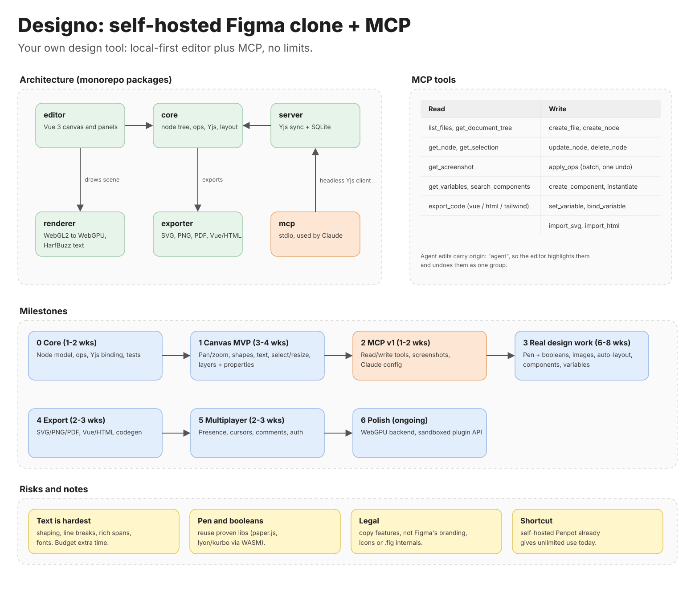

# Designo

A personal, self-hosted design tool in the spirit of Figma, with its own MCP server, so you and
your agents can design without usage limits. Local-first: your files live on your disk.

## Plan

[](https://claude.ai/artifact/V8reHYNtJRQpuMm3M6diRx)

The image links to the [plan whiteboard](https://claude.ai/artifact/V8reHYNtJRQpuMm3M6diRx). In
the docs: [architecture](https://cnotv.github.io/designo/architecture) and
[roadmap](https://cnotv.github.io/designo/roadmap).

## Run it

Locally, with Node 24 and pnpm:

```sh
pnpm install
pnpm build && pnpm start     # http://127.0.0.1:3000
```

Or with Docker: `docker compose up -d --build`, on port 3020.

On a cloud server, put your reverse proxy in front of port 3020 with a login.
The repository deploys itself to Hetzner Cloud once a few secrets are set.

The [self-hosting guide](https://cnotv.github.io/designo/guides/self-hosting) covers all three,
including connecting agents to a remote server over SSH. For development, `pnpm dev` runs the
editor with hot reload on port 5320.

## Docs and demo

- **Docs:** [cnotv.github.io/designo](https://cnotv.github.io/designo/), built with Docusaurus
  from `documentation/`.
- **Demo:** the editor on Netlify shows a sample file, since no server is behind it. Self-host to
  keep files and connect agents.

Connect an agent to the MCP server with the
[MCP guide](https://cnotv.github.io/designo/guides/mcp). Claude Code in this repository picks the
server up from `.mcp.json`.

## What works today

- **`@designo/core`:** the document model. Nodes (page, frame, group, rectangle, ellipse, text),
  atomic batches of create, update, delete and move operations, tree and paint-order queries.
- **`@designo/mcp`:** an MCP server over stdio with `list_files`, `create_file`,
  `get_document_tree`, `get_node`, `create_node`, `update_node`, `delete_node` and `apply_ops`.
- **`@designo/storage`:** validated, atomic reads and writes of `.designo.json` files.
- **`@designo/editor`:** a Vue 3 viewer that draws files on a canvas and follows edits live.
  Editing tools come in phase 1.

## Development

```sh
pnpm lint:check && pnpm format:check && pnpm type-check && pnpm test:unit && pnpm build
```

Agent rules and project facts: [AGENTS.md](AGENTS.md).
