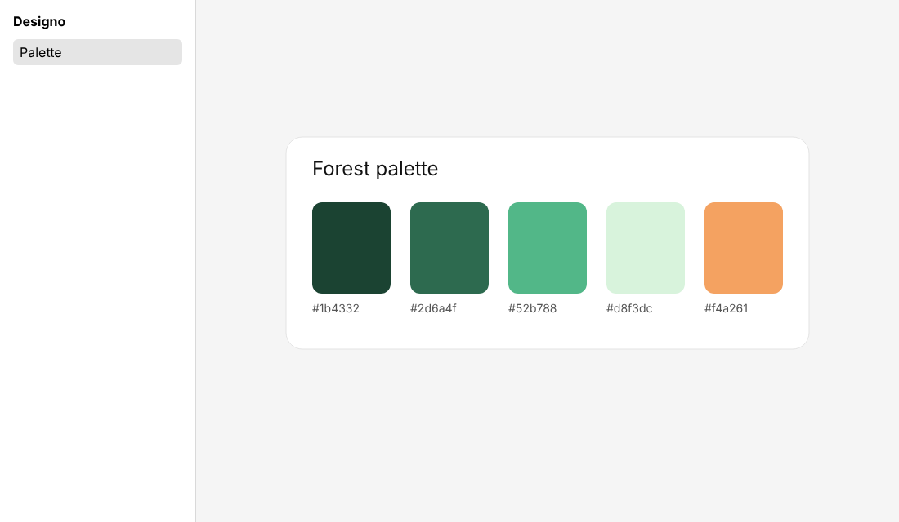

# Designo

A personal, self-hosted design tool in the spirit of Figma, with its own MCP server, so you and
your agents can design without usage limits. Local-first: your files live on your disk.



## Plan

The plan lives on a whiteboard: architecture, MCP tools, milestones and risks.

**[Designo plan whiteboard](https://claude.ai/artifact/V8reHYNtJRQpuMm3M6diRx)**

The same plan in the repository: [architecture](docs/architecture.md) and
[roadmap](docs/roadmap.md).

## Quick start

```sh
pnpm install
pnpm dev        # the editor, at http://localhost:5320
```

Then connect an agent to the MCP server ([setup guide](docs/guides/mcp.md)) and ask it to design
something. The editor shows the agent's changes within a second.

Claude Code picks the server up automatically from `.mcp.json` when it runs in this repository.

## What works today

- **`@designo/core`:** the document model. Nodes (page, frame, group, rectangle, ellipse, text),
  atomic batches of create, update, delete and move operations, tree and paint-order queries.
- **`@designo/mcp`:** an MCP server over stdio with `list_files`, `create_file`,
  `get_document_tree`, `get_node`, `create_node`, `update_node`, `delete_node` and `apply_ops`.
- **`@designo/storage`:** validated, atomic reads and writes of `.designo.json` files.
- **`@designo/editor`:** a Vue 3 viewer that draws files on a canvas and follows edits live.
  Editing tools come in phase 1.

## Development

```sh
pnpm lint:check && pnpm format:check && pnpm type-check && pnpm test:unit && pnpm build
```

Agent rules and project facts: [AGENTS.md](AGENTS.md).
