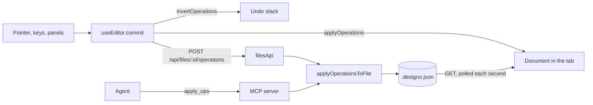

# Architecture

Designo is a pnpm workspace. Every change to a document, whoever makes it, is a
`DesignOperation` applied by `@designo/core`, so the editor, agents and (later) multiplayer
share one path for validation, undo and sync.

```
agent (Claude) ──stdio──▶ @designo/mcp ──▶ @designo/storage ──▶ ~/.designo-data/*.designo.json
                                │                   ▲
                                ▼                   │ dev server /api/files (polled)
                          @designo/core ◀──── @designo/editor (Vue 3, canvas)
```

## Packages

| Package             | Status  | Role                                                                                      |
| ------------------- | ------- | ----------------------------------------------------------------------------------------- |
| `@designo/core`     | built   | Document model, operations, queries. Pure: no DOM, no I/O                                 |
| `@designo/storage`  | built   | Validated, atomic file reads and writes; the operation schema; applying a batch to a file |
| `@designo/mcp`      | built   | MCP server for agents (stdio)                                                             |
| `@designo/auth`     | built   | Accounts, approval rules, signed session cookies and Google sign-in; pure of HTTP         |
| `@designo/exporter` | built   | Pure SVG export of a node; the MCP server rasterizes it to PNG with resvg                 |
| `@designo/editor`   | built   | Vue 3 app: canvas, tools, layers and properties panels; shadcn-vue on Reka UI             |
| `renderer`          | partial | WebGL2 shapes in the editor (#9); text shaping (#10) and hit testing (#11) next           |
| `server`            | phase 5 | Yjs sync, presence and persistence (SQLite); replaces polling                             |
| `exporter` (rest)   | phase 4 | PDF and Vue/HTML code, in-editor PNG                                                      |

## Document model

A document is a flat map of nodes keyed by id. Each node has a `parentId` and an `order`
among its siblings, so a move is a two-field change and concurrent edits merge cleanly once
Yjs arrives. Coordinates are absolute on the page.

`applyOperations` applies a batch atomically: if any operation fails, the document is returned
unchanged. The MCP `apply_ops` tool relies on this, so an agent's half-finished layout never
lands on disk.

## Editing

Every edit, whoever makes it, is a batch of `DesignOperation`s:



- **Pure parts** live in `packages/editor/src/editing/`: viewport maths, hit testing and marquee
  selection, the operations a move, resize or draw produces, history stacks and layer rows. They
  are unit tested without a browser.
- **A drag** previews its operations on a copy of the document and commits once on pointer up, so
  it is one undo step and one save.
- **Undo** applies the inverse batch `invertOperations` worked out before the edit. When an agent
  has changed the file since, an inverse that no longer applies is dropped.
- **Saves** go out in order, one at a time. A poll that started before a local edit is discarded,
  so the tab never flashes back to the file without that edit.
- **The write endpoint** accepts only same-origin `application/json`. On a public deploy the
  browser sends the basic-auth login with every request to the site, including ones another site
  triggers; JSON forces a CORS preflight that the server never approves.
- **Two writers:** the MCP server and the editor's server are separate processes writing the same
  file, each reading it fresh for every batch. Two batches landing in the same instant can still
  lose one; the Yjs sync server in phase 5 removes the race.

## Rendering

The canvas is two stacked layers. The scene below is drawn by a `SceneRenderer`; the overlay on
top, always Canvas 2D, carries selection, guides and the marquee and takes the pointer.

- **Scene.** `buildScene` asks a packed R-tree (`editing/spatialIndex.ts`, Sort-Tile-Recursive,
  rebuilt once per document) for the nodes in view, sorts them back to front and records the
  frames each one is clipped by. `batchScene` splits the list into runs of shapes and runs of
  text, so paint order holds across both.
- **WebGL2.** Each run of shapes is one instanced draw: a quad per node, with a signed distance
  function for the rounded box or ellipse, its stroke and edge antialiasing in the fragment
  shader. Colours are premultiplied. A frame clips through the stencil buffer: each frame in a
  node's chain increments it, and the node draws where it equals the chain's length.
- **Text, for now,** is rasterised per node with Canvas 2D into a texture, cached by content and a
  power-of-two zoom bucket, until HarfBuzz and a glyph atlas replace it (#10).
- **Fallback.** Without WebGL2, or with `?renderer=canvas2d`, the same scene is painted with
  Canvas 2D. A lost WebGL context is rebuilt when the browser restores it.

Tree queries in `@designo/core` group a document's children once and cache the grouping per
document, which is safe because documents are never mutated. Before that, every traversal
scanned all nodes per node, and a flat page of 5,000 layers took over five seconds to list.

## Serving

- **Development:** `pnpm dev` runs Vite, whose `designoFilesPlugin` answers `/api/files`.
- **Self-hosted:** `pnpm start` runs `packages/editor/server/productionServer.ts`, which serves
  the built editor and the same `/api/files` handler (`server/filesApi.ts`). Node runs it
  straight from TypeScript. It listens on loopback unless `HOST` says otherwise. On a server, Compose
  publishes it on `127.0.0.1:3020` for the host's reverse proxy, which adds HTTPS and a login.
- **Static demo:** with no files API (Netlify), `useDesignoFiles` falls back to a bundled sample.
- **MCP:** stdio, which a remote agent reaches through `ssh` and `docker exec`, and, with sign-in
  on, `/mcp` on the production server itself: agents sign in with OAuth in the browser
  (see Accounts below).

Deployment files: `Dockerfile`, `docker-compose.yml`, `netlify.toml` and the workflows in
`.github/workflows`. How to use them: the self-hosting guide.

## Accounts

With `DESIGNO_AUTH=google`, `@designo/auth` adds accounts to the production server; unset, nothing
below exists and the server is single-user as before. An account is a record in `accounts.json`
in the data folder (zod-validated on every read, written atomically with mode 0600): Google's
`sub` it is matched on, the email, whether Google verified it, a status of `pending`, `approved`
or `blocked`, and a random id. A first sign-in is approved at once only for a verified admin or
a verified auto-approved address, and a verified admin is approved again at every sign-in, so the
admin list can never lock anyone out. The id names the account's folder,
`DESIGNO_DATA_DIR/accounts/<id>/`; it is validated before it becomes a path, `/api/files` works
inside that folder only, and `@designo/core` does not know accounts exist. Designs in the data
folder's root stay on disk, visible to no account.

A session is a signed, `HttpOnly` cookie holding the account id, an expiry and the account's
**session epoch**. The account is read from the store on every request, so approval and blocking
apply at once, and a cookie counts only while its epoch equals the stored one. Signing out raises
the epoch, which ends every session of that account, including a copied cookie. The stdio MCP
server takes the account's folder from `DESIGNO_ACCOUNT` (an email) and refuses one that is
missing, pending or blocked. The editor asks `/api/me` first and shows a sign-in, waiting or
blocked screen in front of the editor; with sign-in off the answer is `{ authEnabled: false }`
and no screen appears.

**Admin routes.** `GET /api/admin/accounts` lists the accounts (id, email, name, status, creation
date and whether the account is an admin, nothing else) and
`POST /api/admin/accounts/<id>/status` with `{ "status": "approved" | "blocked" }` approves,
blocks or unblocks one. Admin is derived, never stored: an approved account whose verified email is
in `DESIGNO_ADMIN_EMAILS`, so removing an address takes effect at once. Everyone else, signed out,
pending, blocked or approved without being an admin, gets the same 404 as a path that does not
exist, so the routes do not show themselves. The status change takes the same-origin JSON rule as
every write, validates the id and the body with zod, and refuses to block an admin (409): the
list re-approves an admin at every sign-in, so a block would only last until then, and the check
also keeps an admin from blocking themselves and the last admin from being blocked. A status
change keeps the session epoch, because the status is read on every request and a blocked person
should see that they are blocked. The editor shows an account menu with Sign out, and for admins an
Accounts dialog; what it offers for each status is a pure function in
`packages/editor/src/editing/accountAdministration.ts`.

**Agents sign in (remote MCP).** With sign-in on, the production server is also an OAuth 2.1
authorization server and the MCP resource server, on plain `node:http` with the MCP SDK's
schemas and streamable HTTP transport, no web framework. An agent that opens `/mcp` unauthenticated
gets `401` with `WWW-Authenticate: Bearer resource_metadata=...`; from there the standard flow
runs: the protected-resource and authorization-server metadata under `/.well-known/`, dynamic
registration at `/register` (RFC 7591, public clients only), `/authorize`, `/token` and
`/revoke`. The issuer and every URL in the metadata come from `DESIGNO_PUBLIC_URL`, never from the
`Host` header.

- **Authorize.** The browser needs its Designo session: signed out, it goes through
  `/auth/google` and back to the same request, the return location carried inside the signed login
  cookie and accepted only as a plain same-site path. Only a client and a redirect URI that match
  a registration exactly are answered by redirecting; anything else is an error page, never a
  redirect. PKCE with S256 is required and the `resource` must be the `/mcp` URL. The consent page
  is served by the server: its form carries a signed token tied to the account and to exactly the
  request shown, the post must come from this origin, and the page is sent with
  `X-Frame-Options: DENY`, `frame-ancestors 'none'` and a CSP that allows no script. Allow makes a
  single-use authorization code, held hashed in memory for 60 seconds and bound to client,
  redirect URI, challenge, account and resource; a code used twice also revokes what its first use
  produced.
- **Tokens.** Opaque, 256 random bits. `oauth.json` in the data folder keeps only their SHA-256
  hashes, with the registered clients and the grants (zod-validated on every read, atomic writes
  through one queue, mode 0600). An access token lasts an hour; a refresh token 30 days and is
  traded in at every use, and a traded-in refresh token that comes back revokes the whole grant,
  except for 30 seconds after the trade, when the same new pair is handed out again, because a
  client with an expired token usually refreshes twice at once. Registered clients, grants per
  account and grants overall are capped, with the oldest unused dropped first, and expired entries
  are pruned on write. `/register` and `/token` are rate limited per remote address.
- **`/mcp`.** Stateless: each POST builds the same server as the stdio one (`createDesignoServer`
  from `@designo/mcp`) with `dataDirectory` set to the token's account folder, and a transport
  that lives for that request. The bearer token is looked up, and the account read from the
  account store, on every request, so blocking an account, revoking a grant or an hour passing
  cuts an agent off at once. Tokens do not depend on the browser's session epoch.
- **CORS.** Only the metadata, `/register`, `/token`, `/revoke` and `/mcp` allow other origins;
  they answer to a bearer token and never to the cookie. `/authorize` and `/api/*` allow none.
- **Connected agents.** `GET /api/connections` and `DELETE /api/connections/<id>` (cookie, and the
  same-origin check on the delete) show and end the signed-in account's own grants, nothing
  more. The editor's dialog is `ConnectedAgentsDialog.vue`; what it does with the answers is pure,
  in `packages/editor/src/editing/connectedAgents.ts`.

The pieces: `packages/auth/src/oauth/` (store, authorization codes, PKCE, redirect URI rules,
consent token, rate limiter) holds the logic without HTTP; `packages/editor/server/` has the
routes (`oauthRoutes.ts`, `authorizeRoute.ts`, `tokenRoutes.ts`, `registrationRoute.ts`,
`mcpEndpoint.ts`, `connectionsRoutes.ts`).

## Files

Files are `<id>.designo.json` in `DESIGNO_DATA_DIR`, by default `~/.designo-data`. Writes go to
a temporary file and are renamed into place, so the editor never reads half a file. File ids
are validated before they become paths.

Every file carries a `formatVersion`. `CURRENT_FORMAT_VERSION` in `@designo/core` is the one
place that names the version this code writes; the zod schema and `createDocument` read it.
`readDocument` (used by the editor's files API and the MCP server alike) runs the raw JSON
through `parseStoredDocument` in `@designo/storage`: it detects the file's version, applies each
step from that version up to the current one in order, then validates with the current schema. A
file newer than the code fails with an error asking for an update, and a gap in the steps fails
rather than guessing.

To bump the format: change the schema, raise `CURRENT_FORMAT_VERSION` from N to N + 1, and add
the entry `N` to `MIGRATION_STEPS` in `packages/storage/src/migrations.ts`, a pure function from
the raw version-N object to a version-(N + 1) one. The pipeline sets `formatVersion` itself. Add a
test in `migrations.test.ts` with a sample of the old file.

| Version | Change                                                                                       | Step                      |
| ------- | -------------------------------------------------------------------------------------------- | ------------------------- |
| 1       | First format; a node turns around its top-left corner                                        |                           |
| 2       | A node turns around its centre; rotated nodes move so they are drawn exactly where they were | `migrateRotationPivot.ts` |

## Decisions

- **UI library:** shadcn-vue, on Reka UI, with Tailwind CSS v4. Its components are copied into
  `packages/editor/src/components/ui` from the shadcn-vue repository, as its CLI does, and themed
  through the CSS variables in `src/style.css`.

## Still open

- **Text shaping:** HarfBuzz compiled to WebAssembly is the likely choice for the WebGL renderer (#10).
