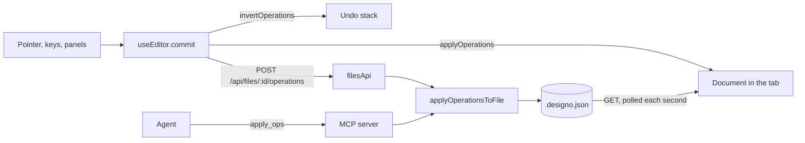

# Architecture

Designo is a pnpm workspace. Every change to a document, whoever makes it, is a
`DesignOperation` applied by `@designo/core`, so the editor, agents and (later) multiplayer
share one path for validation, undo and sync.

```
agent (Claude) ──stdio──▶ @designo/mcp ──▶ @designo/storage ──▶ ~/.designo-data/*.designo.json
                                │                   ▲
                                ▼                   │ dev server /api/files (polled)
                          @designo/core ◀──── @designo/editor (Vue 3, canvas)
```

## Packages

| Package             | Status  | Role                                                                                                         |
| ------------------- | ------- | ------------------------------------------------------------------------------------------------------------ |
| `@designo/core`     | built   | Document model, operations, queries. Pure: no DOM, no I/O                                                    |
| `@designo/storage`  | built   | Validated, atomic file reads and writes; the picture store; the operation schema; applying a batch to a file |
| `@designo/mcp`      | built   | MCP server for agents (stdio)                                                                                |
| `@designo/auth`     | built   | Accounts, approval rules, signed session cookies and Google sign-in; pure of HTTP                            |
| `@designo/exporter` | built   | Pure SVG export of a node, and a PDF of a document (pdfkit, `@designo/exporter/pdf`)                         |
| `@designo/fonts`    | built   | Finds the font files a text needs through the Fontsource API, and reads TrueType files                       |
| `@designo/text`     | built   | Text layout with HarfBuzz: line breaking, shaping, measuring. The editor and MCP share it                    |
| `@designo/editor`   | built   | Vue 3 app: canvas, tools, layers and properties panels; shadcn-vue on Reka UI                                |
| `renderer`          | partial | WebGL2 shapes (#9) and HarfBuzz text from a glyph atlas (#10); hit testing (#11)                             |
| `server`            | phase 5 | Yjs sync, presence and persistence (SQLite); replaces polling                                                |
| `exporter` (rest)   | phase 4 | Vue/HTML code, PDF bleed, trim and CMYK                                                                      |

## Document model

A document is a flat map of nodes keyed by id. Each node has a `parentId` and an `order`
among its siblings, so a move is a two-field change and concurrent edits merge cleanly once
Yjs arrives. Coordinates are absolute on the page.

A document can hold several pages. The root is the first; a `createPage` operation adds more, each
a `page` node with no parent and an `order` among the pages, and the nodes on it hang from it like
any other. `getPageNodes` lists them in order, and the PDF exporter prints one PDF page for each, unless frames carry a `pdfPage`, in which case those frames are its pages.
The editor does not show more than the first page yet.

A frame can also be a printed page. `pageUnit` (`pt` or `mm`), `bleed`, `facing` (`single`, `left`,
`right` or `spread`) and `guides` (margins, columns, gutter, fold) are properties of the node, so
every change is an ordinary `update` operation. Lengths are stored in points, the unit the PDF is
written in; the unit only says how they are shown. `@designo/core` holds the pure parts in
`pageSetup.ts`: unit conversion, `getPageSetupPatch` (a setup in millimetres to the points
stored) and `getPageGuideGeometry` (the trim, bleed, margin and column boxes and the fold). The
editor draws guides as extra scene items placed right after their frame, so they lie over the
frame's fill and under its content; they are never nodes, which is why no exporter, screenshot or
hit test sees them.

`applyOperations` applies a batch atomically: if any operation fails, the document is returned
unchanged. The MCP `apply_ops` tool relies on this, so an agent's half-finished layout never
lands on disk.

## Editing

Every edit, whoever makes it, is a batch of `DesignOperation`s:



- **Pure parts** live in `packages/editor/src/editing/`: viewport maths, hit testing and marquee
  selection, the operations a move, resize or draw produces, history stacks and layer rows. They
  are unit tested without a browser.
- **A drag** previews its operations on a copy of the document and commits once on pointer up, so
  it is one undo step and one save.
- **Undo** applies the inverse batch `invertOperations` worked out before the edit. When an agent
  has changed the file since, an inverse that no longer applies is dropped.
- **Saves** go out in order, one at a time. A poll that started before a local edit is discarded,
  so the tab never flashes back to the file without that edit.
- **The write endpoint** accepts only same-origin `application/json`. On a public deploy the
  browser sends the basic-auth login with every request to the site, including ones another site
  triggers; JSON forces a CORS preflight that the server never approves.
- **Two writers:** the MCP server and the editor's server are separate processes writing the same
  file, each reading it fresh for every batch. Two batches landing in the same instant can still
  lose one; the Yjs sync server in phase 5 removes the race.

## Rendering

The canvas is two stacked layers. The scene below is drawn by a `SceneRenderer`; the overlay on
top, always Canvas 2D, carries selection, guides and the marquee and takes the pointer.

- **Scene.** `buildScene` asks a packed R-tree (`editing/spatialIndex.ts`, Sort-Tile-Recursive,
  rebuilt once per document) for the nodes in view, sorts them back to front and records the
  frames each one is clipped by. `batchScene` splits the list into runs of shapes and runs of
  text, so paint order holds across both. Consecutive texts under the same clipping frames are
  one run, which draws together from the atlas.
- **Hit testing.** Click, hover and marquee ask the same index for the entries near the point or
  box, then sort those few by their paint order, so the cost follows what is nearby, not the
  node count. The editor builds the index once per committed document.
- **WebGL2.** Each run of shapes is one instanced draw: a quad per node, with a signed distance
  function for the rounded box or ellipse, its stroke and edge antialiasing in the fragment
  shader. Colours are premultiplied. A frame clips through the stencil buffer: each frame in a
  node's chain increments it, and the node draws where it equals the chain's length.
- **Text** is drawn from a glyph atlas, and described in its own section below.
- **Fallback.** Without WebGL2, or with `?renderer=canvas2d`, the same scene is painted with
  Canvas 2D. A lost WebGL context is rebuilt when the browser restores it.

## Text

Text is shaped by HarfBuzz, compiled to WebAssembly (`harfbuzzjs`, loaded on first use), laid out
by pure code, and drawn as one textured quad per glyph from a shared atlas. All of it that does not
touch a canvas or a GL context is tested in Node. The layout itself (fonts, shaping, line breaking,
the engine) is `@designo/text`, shared by the editor and the MCP server; the glyph atlas and the
browser font handling stay in `packages/editor/src/rendering/text/`.

- **Fonts.** No font ships with Designo. `listFontCandidates` in `@designo/core` turns a node's
  `fontFamily`, a CSS-like list, into the families to look up: those it names, with fonts the API
  cannot have (Georgia, Arial and others) replaced by open stand-ins with the same letter widths,
  generic names by a real family, then the fallbacks: Inter, Noto Sans Arabic, Hebrew and
  Devanagari, Noto Sans Symbols and Symbols 2. `@designo/fonts` asks the Fontsource API for each,
  validated by a schema in `@designo/storage`, and gets one TrueType file per subset (Latin,
  Cyrillic and so on) with the characters it was cut for, served by jsDelivr. In the editor the
  font library turns a list into a catalog, the first family's files first, its Latin file the
  default that sets the baseline, and loads each file once, when a text needs it, into a store
  every list shares. A character goes to the first file whose range names it; once that file has
  loaded its own glyphs decide, because a subset can lack a character its range names. Letters go
  to the first file that has them; a space, digit or punctuation mark stays with the file of the
  text around it.
- **Layout.** `layoutText` breaks lines with `Intl.Segmenter` and shaped advances, orders
  mixed-direction lines with a subset of the Unicode bidirectional algorithm, aligns them and
  returns every glyph's position. The `TextEngine` wraps it: it loads the fonts a text needs, asks
  `layoutText` once per (text, font family, size, line height, alignment, wrap width) and keeps the
  result, so panning and zooming shape nothing. Only a fixed-width node (`textWrap`) wraps, so
  every auto-width node of the same words shares one layout.
- **Atlas.** `createGlyphAtlas` packs glyph bitmaps into 2048 by 2048 pages of 8-bit coverage, up
  to four, with a shelf packer. A glyph is drawn once per zoom bucket, the device pixels per em
  rounded up to a power of two between 8 and 256, however many nodes use it; zooming inside a
  bucket only scales its quads. When the pages are full the one unused longest is cleared, but
  never one used since `beginFrame`, so a frame cannot lose a glyph it already placed; a glyph that
  cannot be placed makes its node fall back.
- **Rasteriser.** The outline from HarfBuzz (`glyphToPath`) is filled with `Path2D` on an
  `OffscreenCanvas` at the bucket's size and its alpha channel is the coverage. Plain coverage was
  chosen over a signed distance field, which was not built: a glyph is drawn at the size it is
  shown at or within a factor of two of it, which plain coverage handles, and the glyph path then
  needs no second shader. The measured comparison with the browser's own text is in the journey
  note.
- **Draw.** `buildTextDrawList` turns a run of text nodes into vertex data, four vertices a glyph
  (world position with the node's rotation already applied, atlas position as 16-bit integers, the
  premultiplied fill with the node's opacity as four bytes), and a list of steps: one draw per run
  of glyphs on the same atlas page, in paint order, and a fallback step for each node the glyph
  path cannot draw. Quads are plain indexed triangles over one shared index pattern, not
  instances: software GL (headless Chromium, machines with no GPU) drew 60,000 instanced quads
  1.4 s a frame and the same quads as triangles 42 ms. An upright node's glyph corners are snapped
  to the device's pixel grid, so a glyph drawn at its bucket's size is not filtered across two
  pixels; turned text is not snapped. `createAtlasTextures` applies the atlas's evictions and
  uploads to the GPU textures each frame.
- **Fallback.** A node is drawn the Canvas 2D way, as a texture of its own, while its fonts or
  HarfBuzz are still loading (the scene draws again when they arrive), when its text holds a
  character none of its fonts draws (emoji, CJK: the browser's own fonts draw it, in colour), when
  the font API cannot be reached, when its glyphs are shown larger than 512 device pixels per em, and when a glyph does
  not fit the atlas. Without WebGL2, or without WebAssembly, every text takes that path for good.
  `layoutFallbackText` gives it the same lines, alignment, line height and wrap width through the
  same chunking and greedy fill as the shaped layout, measured by the browser, so it can differ
  from the shaped layout by a kerning pair at a word boundary. A glyph a font lacks draws that
  font's missing-glyph shape.
- **Editing.** A text node's box comes from the layout: `createPropertyOperations` sizes it with a
  `TextBoxMeasurer`, which asks the engine for the layout the canvas draws (the browser's
  measurement while fonts load, a character-count estimate where there is no canvas). A fixed-width
  box keeps its width and is as tall as its lines wrap to; an auto-width box is as wide as its
  longest line. The in-place editor is a textarea sized by the same measurement, wrapping (`wrap`
  soft, `white-space: pre-wrap`) and aligned like the drawn text, in the browser's copies of the
  same files: each file is registered as a `FontFace` from the bytes the shaper loaded, with its
  range as `unicode-range`, under a `designo-` name so the app's own Inter is untouched.
- **Screenshots.** `get_screenshot` finds fonts the same way and keeps the files in a cache folder.
  Fixed-width text wraps where the editor wraps it: the server runs the `@designo/text` engine over
  the same fonts (kept in a `layout` folder of the cache, unrenamed because HarfBuzz reads the real
  file) and hands the exporter each line's range of the text. `measure_text` asks the same engine.
  resvg picks one font per family name and, for a missing character, reshapes the whole text with
  another font and keeps the result only when the glyph count matches, so each downloaded file is
  renamed to a family of its own (`designo-` and a hash), a text is drawn with the file that has
  most of its characters, and the files with the rest are loaded for resvg's fallback. Naming a
  font per run of text does not work: resvg shapes the whole line with every run's font and drops
  the text when their glyph counts differ. Lines sit on the alphabetic baseline the editor computes
  from the first family's metrics, read from the file, so mixed fonts share it.
- **Limits.** Bidi is a subset (no explicit embeddings or isolates); there is no CJK or colour emoji
  in the glyph path; text has one font size, weight and colour per node; the glyph path does not
  hint, so a glyph between two zoom buckets is filtered down from the larger; a text box an agent
  creates through the MCP tools keeps the width and height the agent gave it until the text is next
  edited in the editor, which refits it to the layout.

Tree queries in `@designo/core` group a document's children once and cache the grouping per
document, which is safe because documents are never mutated. Before that, every traversal
scanned all nodes per node, and a flat page of 5,000 layers took over five seconds to list.

## Auto-layout

`layoutDocument` in `@designo/core` is a pure function from a document to a document. Frames carry
`layoutMode` (`none`, `horizontal`, `vertical`), `layoutGap`, `layoutPadding`, `layoutAlign` and
`layoutCrossAlign`; every node carries `widthSizing` and `heightSizing` (`fixed`, `hug`, `fill`).
`applyOperation` runs the layout after every operation that succeeds, so the editor, the MCP tools
and undo take the same path and the laid out positions are stored in the file like any others;
a reader needs no engine. A pass has two walks: hugging frames size themselves from the inside
out, then each frame places its children and sizes those that fill, from the outside in. Positions
are absolute, as everywhere. A node that fills takes no part in what a hugging parent measures.
Hidden children are skipped, text keeps its size (the core has no font metrics) and rotation is
ignored. The pass costs O(nodes) per operation and is skipped when no frame uses layout; scope it
to the changed subtrees if a drag in a very large document lags. Dragging a child of a layout frame
snaps it back to its slot; reordering by drag is not built yet.

## Serving

- **Development:** `pnpm dev` runs Vite, whose `designoFilesPlugin` answers `/api/files`.
- **Self-hosted:** `pnpm start` runs `packages/editor/server/productionServer.ts`, which serves
  the built editor and the same `/api/files` handler (`server/filesApi.ts`). Node runs it
  straight from TypeScript. It listens on loopback unless `HOST` says otherwise. On a server, Compose
  publishes it on `127.0.0.1:3020` for the host's reverse proxy, which adds HTTPS and a login.
- **Static demo:** with no files API (Netlify), `useDesignoFiles` falls back to a bundled sample.
- **MCP:** stdio, which a remote agent reaches through `ssh` and `docker exec`, and, with sign-in
  on, `/mcp` on the production server itself: agents sign in with OAuth in the browser
  (see Accounts below).

Deployment files: `Dockerfile`, `docker-compose.yml`, `netlify.toml` and the workflows in
`.github/workflows`. How to use them: the self-hosting guide.

## Accounts

With `DESIGNO_AUTH=google`, `@designo/auth` adds accounts to the production server; unset, nothing
below exists and the server is single-user as before. An account is a record in `accounts.json`
in the data folder (zod-validated on every read, written atomically with mode 0600): Google's
`sub` it is matched on, the email, whether Google verified it, a status of `pending`, `approved`
or `blocked`, and a random id. A first sign-in is approved at once only for a verified admin or
a verified auto-approved address, and a verified admin is approved again at every sign-in, so the
admin list can never lock anyone out. The id names the account's folder,
`DESIGNO_DATA_DIR/accounts/<id>/`; it is validated before it becomes a path, `/api/files` works
inside that folder only, and `@designo/core` does not know accounts exist. Designs in the data
folder's root stay on disk, visible to no account.

A session is a signed, `HttpOnly` cookie holding the account id, an expiry and the account's
**session epoch**. The account is read from the store on every request, so approval and blocking
apply at once, and a cookie counts only while its epoch equals the stored one. Signing out raises
the epoch, which ends every session of that account, including a copied cookie. The stdio MCP
server takes the account's folder from `DESIGNO_ACCOUNT` (an email) and refuses one that is
missing, pending or blocked. The editor asks `/api/me` first and shows a sign-in, waiting or
blocked screen in front of the editor; with sign-in off the answer is `{ authEnabled: false }`
and no screen appears.

**Admin routes.** `GET /api/admin/accounts` lists the accounts (id, email, name, status, creation
date and whether the account is an admin, nothing else) and
`POST /api/admin/accounts/<id>/status` with `{ "status": "approved" | "blocked" }` approves,
blocks or unblocks one. Admin is derived, never stored: an approved account whose verified email is
in `DESIGNO_ADMIN_EMAILS`, so removing an address takes effect at once. Everyone else, signed out,
pending, blocked or approved without being an admin, gets the same 404 as a path that does not
exist, so the routes do not show themselves. The status change takes the same-origin JSON rule as
every write, validates the id and the body with zod, and refuses to block an admin (409): the
list re-approves an admin at every sign-in, so a block would only last until then, and the check
also keeps an admin from blocking themselves and the last admin from being blocked. A status
change keeps the session epoch, because the status is read on every request and a blocked person
should see that they are blocked. The editor shows an account menu with Sign out, and for admins an
Accounts dialog; what it offers for each status is a pure function in
`packages/editor/src/editing/accountAdministration.ts`.

**Agents sign in (remote MCP).** With sign-in on, the production server is also an OAuth 2.1
authorization server and the MCP resource server, on plain `node:http` with the MCP SDK's
schemas and streamable HTTP transport, no web framework. An agent that opens `/mcp` unauthenticated
gets `401` with `WWW-Authenticate: Bearer resource_metadata=...`; from there the standard flow
runs: the protected-resource and authorization-server metadata under `/.well-known/`, dynamic
registration at `/register` (RFC 7591, public clients only), `/authorize`, `/token` and
`/revoke`. The issuer and every URL in the metadata come from `DESIGNO_PUBLIC_URL`, never from the
`Host` header.

- **Authorize.** The browser needs its Designo session: signed out, it goes through
  `/auth/google` and back to the same request, the return location carried inside the signed login
  cookie and accepted only as a plain same-site path. Only a client and a redirect URI that match
  a registration exactly are answered by redirecting; anything else is an error page, never a
  redirect. PKCE with S256 is required and the `resource` must be the `/mcp` URL. The consent page
  is served by the server: its form carries a signed token tied to the account and to exactly the
  request shown, the post must come from this origin, and the page is sent with
  `X-Frame-Options: DENY`, `frame-ancestors 'none'` and a CSP that allows no script. Allow makes a
  single-use authorization code, held hashed in memory for 60 seconds and bound to client,
  redirect URI, challenge, account and resource; a code used twice also revokes what its first use
  produced.
- **Tokens.** Opaque, 256 random bits. `oauth.json` in the data folder keeps only their SHA-256
  hashes, with the registered clients and the grants (zod-validated on every read, atomic writes
  through one queue, mode 0600). An access token lasts an hour; a refresh token 30 days and is
  traded in at every use, and a traded-in refresh token that comes back revokes the whole grant,
  except for 30 seconds after the trade, when the same new pair is handed out again, because a
  client with an expired token usually refreshes twice at once. Registered clients, grants per
  account and grants overall are capped, with the oldest unused dropped first, and expired entries
  are pruned on write. `/register` and `/token` are rate limited per remote address.
- **`/mcp`.** Stateless: each POST builds the same server as the stdio one (`createDesignoServer`
  from `@designo/mcp`) with `dataDirectory` set to the token's account folder, and a transport
  that lives for that request. The bearer token is looked up, and the account read from the
  account store, on every request, so blocking an account, revoking a grant or an hour passing
  cuts an agent off at once. Tokens do not depend on the browser's session epoch.
- **CORS.** Only the metadata, `/register`, `/token`, `/revoke` and `/mcp` allow other origins;
  they answer to a bearer token and never to the cookie. `/authorize` and `/api/*` allow none.
- **Connected agents.** `GET /api/connections` and `DELETE /api/connections/<id>` (cookie, and the
  same-origin check on the delete) show and end the signed-in account's own grants, nothing
  more. The editor's dialog is `ConnectedAgentsDialog.vue`; what it does with the answers is pure,
  in `packages/editor/src/editing/connectedAgents.ts`.

The pieces: `packages/auth/src/oauth/` (store, authorization codes, PKCE, redirect URI rules,
consent token, rate limiter) holds the logic without HTTP; `packages/editor/server/` has the
routes (`oauthRoutes.ts`, `authorizeRoute.ts`, `tokenRoutes.ts`, `registrationRoute.ts`,
`mcpEndpoint.ts`, `connectionsRoutes.ts`).

## Files

Files are `<id>.designo.json` in `DESIGNO_DATA_DIR`, by default `~/.designo-data`. Writes go to
a temporary file and are renamed into place, so the editor never reads half a file. File ids
are validated before they become paths.

Every file carries a `formatVersion`. `CURRENT_FORMAT_VERSION` in `@designo/core` is the one
place that names the version this code writes; the zod schema and `createDocument` read it.
`readDocument` (used by the editor's files API and the MCP server alike) runs the raw JSON
through `parseStoredDocument` in `@designo/storage`: it detects the file's version, applies each
step from that version up to the current one in order, then validates with the current schema. A
file newer than the code fails with an error asking for an update, and a gap in the steps fails
rather than guessing.

To bump the format: change the schema, raise `CURRENT_FORMAT_VERSION` from N to N + 1, and add
the entry `N` to `MIGRATION_STEPS` in `packages/storage/src/migrations.ts`, a pure function from
the raw version-N object to a version-(N + 1) one. The pipeline sets `formatVersion` itself. Add a
test in `migrations.test.ts` with a sample of the old file.

| Version | Change                                                                                                             | Step                       |
| ------- | ------------------------------------------------------------------------------------------------------------------ | -------------------------- |
| 1       | First format; a node turns around its top-left corner                                                              |                            |
| 2       | A node turns around its centre; rotated nodes move so they are drawn exactly where they were                       | `migrateRotationPivot.ts`  |
| 3       | Every node carries `textAlign`, `lineHeight` and `textWrap`; old files get the defaults, which draw text as before | `migrateTextProperties.ts` |
| 8       | Every node carries `pageUnit`, `bleed`, `facing` and `guides`; old files get no bleed and no guides                | `migratePageSetup.ts`      |
| 9       | Every node carries `imageAsset`, for the image node; old files get none, so they draw as before                    | `migrateImages.ts`         |
| 10      | Every node carries `imageFit` (`stretch`, `fit` or `fill`); old files get `stretch`, so they draw as before        | `migrateImageFit.ts`       |
| 11      | Every node carries `link`; old files get none, so they export as before                                            | `migrateLinks.ts`          |

A new property every node carries needs a version, even with a default: the stored schema requires
every property, so version 3 added `textAlign` (`left`), `lineHeight` (`1.2`) and `textWrap`
(`false`) through `migrateTextProperties.ts` rather than loosening the schema. The migration holds
its own copy of the defaults, so a later change to the live defaults never rewrites an old step.

A text node is one of two boxes. With `textWrap` false its `width` follows its words and its lines
break only at newlines; with `textWrap` true the `width` is a wrap width, which the layout in
`@designo/text` breaks lines at. The SVG exporter has no shaper of its own: it breaks a fixed-width
text where the `getTextLines` option says, and the MCP server fills that from the layout engine.
Without the option it aligns lines inside the `width` but never wraps them.

## Pictures

An image node holds `imageAsset`, the id of a picture in the asset store, never the bytes. The
store is the `assets/` folder of the data directory, and an id is the SHA-256 of the file plus its
type (`<64 hex>.png`), so the same picture is kept once. `writeAsset` in `@designo/storage` decides
the type from the file's first bytes, caps the size at 20 MB and refuses everything but PNG, JPEG,
WebP and GIF, so no script can be stored as a picture. The editor server reaches the store at
`/api/files/assets` (POST an image, GET `assets/<id>`), and the MCP `add_image` tool writes to it
directly. `imageFit` says how the picture meets the node's box, worked out once by `getImagePlacement` in
`@designo/core` for the editor's renderers; SVG maps it to `preserveAspectRatio`, and the PDF draws
a picture that is not stretched through the rasteriser. A renderer that cannot read the picture
draws the node's fill. The SVG exporter takes
a `getImageHref` option and the PDF exporter a `getImageBytes` one; the MCP server fills both from
the store, and the editor draws from `/api/files/assets` through an in-memory cache.

## Decisions

- **UI library:** shadcn-vue, on Reka UI, with Tailwind CSS v4. Its components are copied into
  `packages/editor/src/components/ui` from the shadcn-vue repository, as its CLI does, and themed
  through the CSS variables in `src/style.css`.

## Still open
