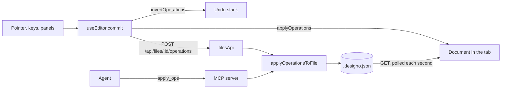

# Architecture

Designo is a pnpm workspace. Every change to a document, whoever makes it, is a
`DesignOperation` applied by `@designo/core`, so the editor, agents and (later) multiplayer
share one path for validation, undo and sync.

```
agent (Claude) ──stdio──▶ @designo/mcp ──▶ @designo/storage ──▶ ~/.designo-data/*.designo.json
                                │                   ▲
                                ▼                   │ dev server /api/files (polled)
                          @designo/core ◀──── @designo/editor (Vue 3, canvas)
```

## Packages

| Package            | Status  | Role                                                                                      |
| ------------------ | ------- | ----------------------------------------------------------------------------------------- |
| `@designo/core`    | built   | Document model, operations, queries. Pure: no DOM, no I/O                                 |
| `@designo/storage` | built   | Validated, atomic file reads and writes; the operation schema; applying a batch to a file |
| `@designo/mcp`     | built   | MCP server for agents (stdio)                                                             |
| `@designo/editor`  | built   | Vue 3 app: canvas, tools, layers and properties panels; shadcn-vue on Reka UI             |
| `renderer`         | #5      | WebGL2 scene renderer, WebGPU later; replaces the Canvas 2D stopgap                       |
| `server`           | phase 5 | Yjs sync, presence and persistence (SQLite); replaces polling                             |
| `exporter`         | phase 4 | SVG, PNG, PDF and Vue/HTML code                                                           |

## Document model

A document is a flat map of nodes keyed by id. Each node has a `parentId` and an `order`
among its siblings, so a move is a two-field change and concurrent edits merge cleanly once
Yjs arrives. Coordinates are absolute on the page.

`applyOperations` applies a batch atomically: if any operation fails, the document is returned
unchanged. The MCP `apply_ops` tool relies on this, so an agent's half-finished layout never
lands on disk.

## Editing

Every edit, whoever makes it, is a batch of `DesignOperation`s:



- **Pure parts** live in `packages/editor/src/editing/`: viewport maths, hit testing and marquee
  selection, the operations a move, resize or draw produces, history stacks and layer rows. They
  are unit tested without a browser.
- **A drag** previews its operations on a copy of the document and commits once on pointer up, so
  it is one undo step and one save.
- **Undo** applies the inverse batch `invertOperations` worked out before the edit. When an agent
  has changed the file since, an inverse that no longer applies is dropped.
- **Saves** go out in order, one at a time. A poll that started before a local edit is discarded,
  so the tab never flashes back to the file without that edit.
- **The write endpoint** accepts only same-origin `application/json`. On a public deploy the
  browser sends the basic-auth login with every request to the site, including ones another site
  triggers; JSON forces a CORS preflight that the server never approves.
- **Two writers:** the MCP server and the editor's server are separate processes writing the same
  file, each reading it fresh for every batch. Two batches landing in the same instant can still
  lose one; the Yjs sync server in phase 5 removes the race.

## Serving

- **Development:** `pnpm dev` runs Vite, whose `designoFilesPlugin` answers `/api/files`.
- **Self-hosted:** `pnpm start` runs `packages/editor/server/productionServer.ts`, which serves
  the built editor and the same `/api/files` handler (`server/filesApi.ts`). Node runs it
  straight from TypeScript. It listens on loopback unless `HOST` says otherwise. On a server, Compose
  publishes it on `127.0.0.1:3020` for the host's reverse proxy, which adds HTTPS and a login.
- **Static demo:** with no files API (Netlify), `useDesignoFiles` falls back to a bundled sample.
- **MCP:** stdio only. A remote agent reaches it through `ssh` and `docker exec`, so it needs no
  network listener or login of its own.

Deployment files: `Dockerfile`, `docker-compose.yml`, `netlify.toml`,
`deploy/hetzner/cloud-init.yaml`, and the workflows in `.github/workflows`. How to use them:
the self-hosting guide.

## Files

Files are `<id>.designo.json` in `DESIGNO_DATA_DIR`, by default `~/.designo-data`. Writes go to
a temporary file and are renamed into place, so the editor never reads half a file. File ids
are validated before they become paths.

## Decisions

- **UI library:** shadcn-vue, on Reka UI, with Tailwind CSS v4. Its components are copied into
  `packages/editor/src/components/ui` from the shadcn-vue repository, as its CLI does, and themed
  through the CSS variables in `src/style.css`.

## Still open

- **Text shaping:** HarfBuzz compiled to WebAssembly is the likely choice for the WebGL renderer.
